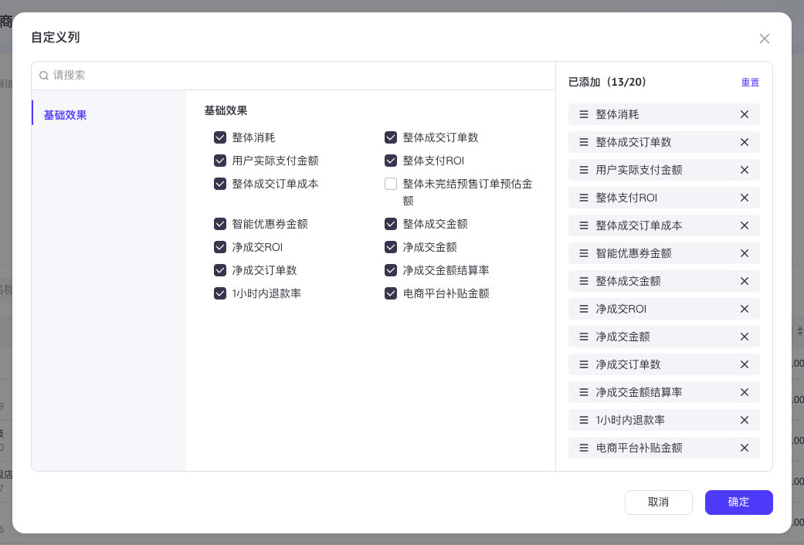
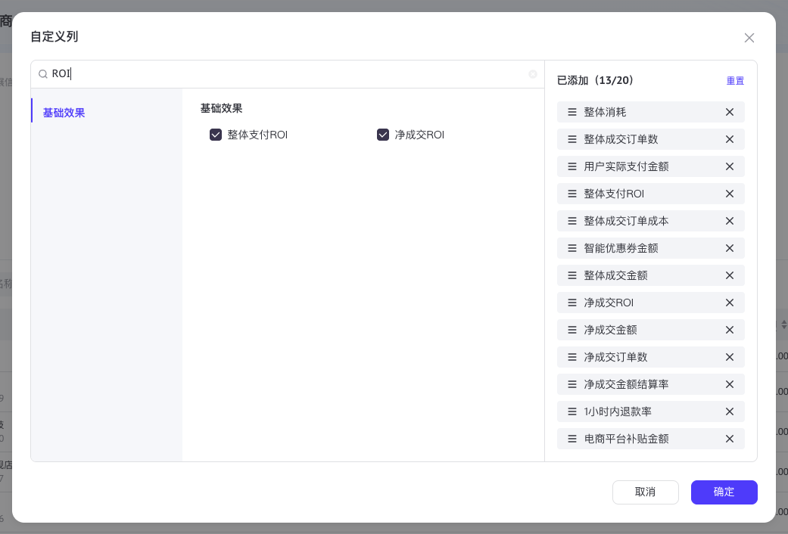
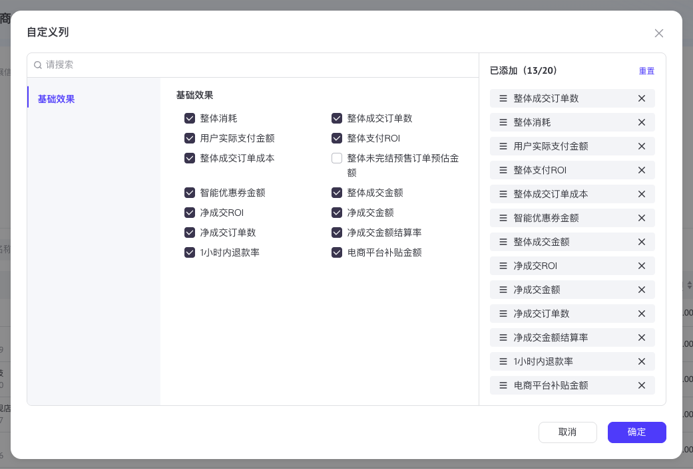

# 自定义列

模板：[`ColumnChooserDialog.tsx`](../templates/ColumnChooserDialog.tsx)。用于编辑列的可见性及顺序；标题固定为「自定义列」，字体继承项目 `font-sans`。

## 原站参考

原站默认、搜索与拖动调序状态均通过 ego-browser 采集，计算样式和截图分别保存；本地对照规则见 `verify.json`。

| 状态 | 路径 |
|---|---|
| 默认 | [shots/column-chooser.png](shots/column-chooser.png) |
| 搜索 | [shots/column-chooser-search.png](shots/column-chooser-search.png) |
| 调序 | [shots/column-chooser-reordered.png](shots/column-chooser-reordered.png) |
| 计算样式与来源 | [specs/column-chooser.json](specs/column-chooser.json) |

## 实测规格

| 部位 | 规格 |
|---|---|
| 弹窗 | 白底，宽 1009px，圆角 16px；视口四边至少 16px，`max-height:calc(100dvh - 32px)` |
| 高度 | 原站约 674.39px，由标题、532px 内容与页脚共同撑开，不固定弹窗总高度 |
| 标题 | 16px / 18.4px、700、`#31343b`；内边距 `24px 24px 20px`，右上角独立关闭按钮 |
| 内容框 | 左右外边距 24px，原站 961 × 532px，1px `#dee0e3` 边框，圆角 8px；视口高度不足时收缩 |
| 左侧 | 实测宽 679px；搜索横跨分类与选项；与已选区之间 1px `#dee0e3` 分隔线 |
| 搜索 | 高 36px，内边距 `4px 8px`，16px 搜索图标，透明白底输入框，下边框 1px |
| 分类 | 宽 200px，背景 `#f5f7fa`；行高 32px，左右内边距 16px，文字 14px / 22px；当前项蓝色 `#0057ff`、700，左侧蓝色标记 |
| 选项区 | 原站采样约 471px（含左右 16px 内边距及右分隔）；模板按左侧剩余宽度伸缩，不硬编码该采样宽度 |
| 分类标题 | 14px / 22px、600，下外边距 12px |
| 选项网格 | 两等宽列，横向间距 16px、纵向间距 8px；左内边距 12px、下内边距 12px |
| 复选框 | Base UI Checkbox，16 × 16px，圆角 4px，1px 边框；选中背景及边框 `#38374f`，白色勾选图标 |
| 选项文字 | 14px / 22px、400、`#31343b`；长文字允许换行，完整标签保留在 DOM 与 `title` 中 |
| 已选区 | 桌面宽 280px，内边距 16px；标题行高 22px；标题 14px / 22px、600，显示当前数量及上限 |
| 恢复默认 | 蓝色按钮，高 22px，12px / 18px |
| 已选列表 | 上内边距 16px；行高 28px，纵向间距 8px；背景 `#f2f4f7`，圆角 4px，内边距 `3px 12px` |
| 已选行 | 14px / 22px、400；16px 拖动图标，图标与文字间距 8px，16px 移除按钮 |
| 页脚 | 内边距 24px，右对齐，按钮间距 16px；按钮 88 × 32px、圆角 8px；取消边框 `#dfe0e2`，确定背景 `#0057ff` |
| 滚动 | 分类、选项、已选列表独立滚动；滚动容器均允许收缩且限制滚动传递，标题与页脚保持可见 |
| 窄屏 | 小于项目 `md` 断点时分类为横向滚动条，选项与已选区上下排列，各自保留滚动区；小于 `sm` 时选项为单列，保留长名称；弹窗宽度不超过视口减 32px |

遮罩与阴影沿用 `SelectionDialog`：遮罩 `rgba(26,26,27,0.5)`，阴影 `0 3px 9px rgba(0,0,0,0.08)`。按钮复用 `ControlButton`，图标统一 Lucide，不增加依赖。

## Props 与数据接入

| Prop | 类型 | 契约 |
|---|---|---|
| `open` | `boolean` | 由调用方控制显示 |
| `value` | `readonly string[]` | 已应用的列 ID，数组顺序就是展示顺序；每次打开以此创建草稿 |
| `options` | `readonly ColumnChooserOption[]` | 可选列，按传入顺序显示；分类从 `category` 首次出现的顺序派生 |
| `defaultValue` | `readonly string[]` | 恢复默认时使用的列 ID 及顺序；只修改草稿 |
| `max` | `number`，默认 `20` | 最大列数，必选列也计入；有限值向下取整且至少为 1，非有限值回退到 20 |
| `onApply` | `(value: string[]) => void` | 收到一份新的有序 ID 数组；调用方更新 `value` 并驱动实际表格 |
| `onOpenChange` | `(open: boolean) => void` | 调用方同步受控 `open`；成功应用先调用 `onApply`，再请求关闭 |

`ColumnChooserOption` 为 `{ id: string; label: string; category: string; required?: boolean }`。ID 必须唯一且稳定，标签和分类使用实际业务术语，类别字符串兼作类别标识。`required` 默认为 `false`：必选列自动加入草稿，不能取消或移除，仍可调序。

调用方必须提供完整列定义、当前值、默认值和最大数量，并在确认后按返回的 ID 数组映射真实表格列。不要使用数组下标作为列 ID，也不要在模板中写入账户、客户、原站指标或品牌数据。异步加载的业务应在列定义就绪后开放入口。需要同时复制 `ControlButton.tsx` 与 `cn.ts`；已有同类工具时调整导入并复用宿主实现。Skill 预览使用本目录的独立 Motion 依赖，接入业务时复用宿主已安装的版本。

未知 ID 会被忽略，重复选择 ID 会去重，超出上限的可选列按输入顺序截断，并优先预留必选列名额；缺失必选列按 `options` 顺序追加。必选列数量必须不超过 `max`；配置冲突会显示错误并禁用确定。调用方不要依赖纠正逻辑替代有效数据。

## 交互与可访问性

| 操作 | 行为 |
|---|---|
| 打开 | 初始化独立草稿、清空搜索、回到首个分类；打开期间父级 `value` 更新不会覆盖当前编辑 |
| 搜索 | 按标签或 ID 忽略大小写匹配；保留有匹配结果的分类，当前分类无匹配时显示首个匹配分类；选中项及顺序不受过滤影响 |
| 分类 | 点击或通过 Tab 后按 Enter / Space 切换；按钮以 `aria-pressed` 标识当前分类 |
| 勾选 | 追加到已选末尾；达到上限时未选项原生禁用并降低透明度，已选项仍可取消 |
| 移除 | 删除对应列；焦点移动到相邻已选项手柄，列表为空时返回搜索框；必选项禁用移除 |
| 恢复默认 | 替换草稿为默认顺序并补齐必选列，不提前更新外部 `value` |
| 鼠标 / 触屏排序 | 使用项目已有 `framer-motion@11.18.2` 的 `Reorder.Group` / `Reorder.Item`；仅手柄通过 `useDragControls` 启动拖动，点击标签或移除按钮不启动拖动 |
| 键盘排序 | 聚焦手柄，`ArrowUp` / `ArrowDown` 移动一项，`Home` / `End` 移至首尾；保留手柄焦点并使当前行可见；边界位置保持不变 |
| 播报 | `role="status"` 播报调整后的名称、位置和总数，播报移除及恢复默认；隐藏说明通过 `aria-describedby` 关联手柄 |
| 确定 | 至少一列且不超上限时可用；按草稿顺序调用 `onApply` 后关闭，零列时显示「至少选择一列」并原生禁用按钮 |
| 取消 / Escape / 点击遮罩 / 外部关闭 | 不调用 `onApply`；销毁草稿，下次打开重新读取 `value` |
| 焦点 | Base UI Dialog 提供模态焦点限制与关闭恢复；取消使用 `Dialog.Close`；保留默认初始焦点规则，触屏不强制唤起搜索键盘；按钮、分类、复选框与手柄都有可见焦点 |

与原站的显式差异：调序实现复用现有 Motion；手柄的键盘移动、隐藏操作说明和状态播报为附加能力。尊重减少动态效果偏好；不会引入第二套拖放依赖。面板高度从内容计算，窄屏上下排列是响应式补充。错误信息仅在零列或必选列配置冲突时出现，常态不添加次要说明。

## 验证锚点

根节点为 `[data-ui="column-chooser"][data-ui-part="panel"]`。以下均为根节点内的 `data-ui-part`：

| 范围 | 锚点 |
|---|---|
| 布局 | `panel`、`title`、`body`、`footer` |
| 浏览与选择 | `search`（包裹输入框）、`menu`、`category`、`options`、`option`、`checkbox` |
| 已选与排序 | `selected`、`selected-title`、`selected-row`、`selected-label`、`drag-handle`、`remove`、`reset` |
| 事务按钮 | `cancel`、`apply` |

`option` / `checkbox` 带 `data-option-id` 与 `data-state="checked|unchecked"`；`selected-row` 带 `data-row-id`、`data-option-id` 与 `data-state="checked"`。必选项与对应行带 `data-required="true"`。分类带 `data-category` 与 `data-state="active|inactive"`。禁用状态使用 Base UI 或原生按钮语义。

`capture.json` 登记原站默认、搜索和拖动调序步骤；`verify.json` 对照稳定部位属性，并输出本地截图。`gallery` 中“自定义指标”驱动指标顺序，“选择列”驱动表格可见列，两者各自保留已应用状态。维护时检查取消与 Escape 不提交、重开恢复当前值、搜索跨分类、达到上限、全部取消、恢复默认、有序应用、手柄拖动和键盘首尾移动、焦点恢复，以及窄屏独立滚动。
