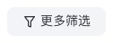
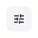
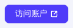
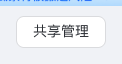
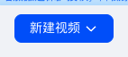
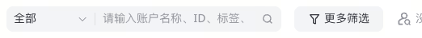

# 按钮与搜索

| 组件 | 截图 | 模板 |
|---|---|---|
| 灰底文字 / 图标按钮 |  | `ControlButton variant="filled"` |
| 图标按钮 |  | `ControlButton variant="icon"` |
| 主按钮 |  | `ControlButton variant="primary"` |
| 描边次要按钮 |  | `OutlineButton` / `ControlButton variant="outline"` |
| 下拉主按钮 |  | `DropdownButton` |
| 下拉菜单展开 |  | `DropdownButton` 展开态 |
| 搜索 + 范围选择 |  | `SearchFilter.tsx` |

## 按钮

| 部位 | 规格 |
|---|---|
| 通用 | 高 32px、圆角 8px、1px 描边、14px / 22px、400 |
| 文字按钮 | 内边距 `4px 16px`，图标 16px，图文间距 4px |
| 灰底 | 背景和描边 `#F2F4F7`，文字 `#31343B` |
| 图标按钮 | 32×32px，无文字，16×16px 图标居中；可见操作文字放入 `aria-label` |
| 主按钮 | 背景和描边 `#0057FF`，白色文字 |
| 描边按钮 | 背景 `#FFFFFF`，描边 `#DFE0E2`（1px solid），文字 `#31343B`，参考“共享管理” |
| 下拉按钮 | 主色背景 `#0057FF`，文字右侧 4px 紧随 16px 下拉箭头；展开时指示符旋转 180°；参考“新建视频” |
| 下拉菜单 | 宽 220px，背景 `#FFFFFF`，圆角 8px，阴影 `0 3px 9px rgba(0,0,0,0.08)`，上下内边距 6px；选项带标题（14px / `#31343B`）与二级说明（12px / `#93969D`），高度 52px，悬停高亮 `#F2F4F7` |
| 链接 | 使用 a + 真实 href；`#0057FF`、无下划线；有动作但无跳转才用 button |
| 键盘 | 可见焦点，禁用态无点击行为；图标统一 Lucide |

`link` 变体是按同一视觉语言补齐的模板，尚无这次页面的独立参考截图。Hover 色的默认模板也属于实现选择，默认态数值以 JSON 为准。

## 搜索与筛选

| 部位 | 规格 |
|---|---|
| 高度 | 32px、圆角 8px |
| 背景 | 输入区与选择区 `#F2F4F7` |
| 文字 | 14px / 22px、400、`#31343B`；占位符 `#93969D` |
| 内边距 | `4px 8px` |
| 分组 | 左选择框宽 110px，右输入弹性宽度，总宽参考值 340px；不是固定要求 |
| 接缝 | 有范围选择时，左区只有左圆角，右区只有右圆角；无范围选择时输入区四角均为 8px；不叠加外框 |

`SearchFilter` 保留原生 select 的轻量组合，并由调用方控制 query / scope。需要独立的前缀筛选框、单选、多选、全选、已选标签或类型级联时，使用 [filters.md](filters.md) 的 `FilterSelect` / `MultiFilterSelect` / `CascadingFilter`；它们复用已有 Base UI，不增加第二套浮层库。
