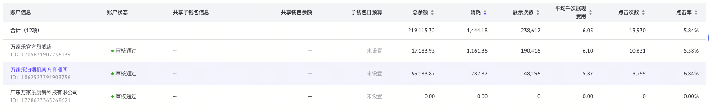

# 数据表格

| 部位 | 规格 |
|---|---|
| 外框 | 白色内容区内，不加外边框、不加竖分隔线，超宽时横向滚动 |
| 文字 | 12px / 18px、`#31343B` |
| 表头 | 高 42px、背景 `#F2F4F7`、700；单元格左右内边距 16px |
| 合计行 | 位于表头之后，白底、高 42px、500、左右内边距 16px |
| 普通行 | 双行内容高 53px、上下内边距 8px、左右 16px，常规 400 |
| 分隔线 | 每行下方 1px `#DFE0E2`，含合计行 |
| 主信息 | 名称第一行；ID 第二行，12px / 18px，`#93969D` |
| 数字列 | 右对齐；表内数字用 `tabular-nums`，金额和百分比保留同列一致精度 |
| 空值 | `--`；未设置状态用 `#93969D` |
| 悬停 | 单元格背景 `#F2F5FD`，整行同步，不移动行高 |
| 状态 | 小圆点 + 可读文字，不仅依靠绿色表达 |
| 排序 | 可点击表头，灰色上下箭头，当前方向蓝色；`aria-sort` 反映真实排序 |
| 分页 | 表格下方间距 16px，右对齐，控件高 24px，当前页细蓝色描边、圆角 8px |

## 实现

模板：`templates/DataTable.tsx`。保留原生 table / th / td 的结构；由上层提供 `rows`、`summary`、`sort`、`page`、`total` 与回调。

排序、分页、筛选属于同一数据查询。服务端分页的合计值必须来自接口，不能把当前页相加当成全量合计。模板不内置数据请求；预览页用本地夹具演示操作。

模板只保留通用页码、前后翻页和当前每页条数；原站的跳页输入和修改每页条数尚未抽为可交互模板。原站分页原始值仍保留在 `specs/data-table.json`。
