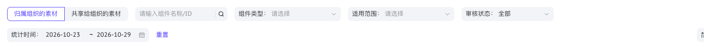
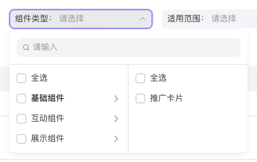
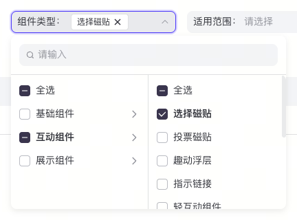
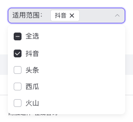
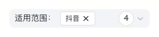
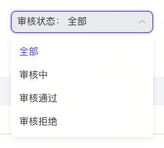

# 筛选框

来源为创意组件素材页，字体继续继承项目 `font-sans`。连体切换 Tab 见 [tabs.md](tabs.md)。三个筛选保持相同的填充输入框外观，内部按单选、多选、两级级联分别处理。

| 用法 | 模板 | 选择方式 |
|---|---|---|
| 审核状态 | [`FilterSelect.tsx`](../templates/FilterSelect.tsx) 中的 `FilterSelect` | 单选，选中后收起；「全部」作为显式选项 |
| 适用范围 | 同文件中的 `MultiFilterSelect` | 多选、全选、部分选中，选择立即生效，浮层保留 |
| 组件类型 | [`CascadingFilter.tsx`](../templates/CascadingFilter.tsx) | 两级叶子多选，支持全局 / 分类全选、搜索与路径高亮 |

## 原站截图

| 状态 | 截图与样式 |
|---|---|
| 筛选栏默认 | [material-filters.png](shots/material-filters.png) · [JSON](specs/material-filters.json) |
| 类型一级 / 两级展开 | [type-filter-open.png](shots/type-filter-open.png) · [type-filter-cascade.png](shots/type-filter-cascade.png) |
| 类型搜索 / 已选 / 部分选中 | [type-filter-search.png](shots/type-filter-search.png) · [type-filter-selected.png](shots/type-filter-selected.png) · [type-filter-partial.png](shots/type-filter-partial.png) |
| 范围展开 / 部分选中 / 全选 / 悬停 | [scope-filter-open.png](shots/scope-filter-open.png) · [scope-filter-selected.png](shots/scope-filter-selected.png) · [scope-filter-all.png](shots/scope-filter-all.png) · [scope-filter-hover.png](shots/scope-filter-hover.png) |
| 审核展开 / 已选 | [audit-filter-open.png](shots/audit-filter-open.png) · [audit-filter-selected.png](shots/audit-filter-selected.png) |

全部状态均有同名 `specs/*.json`，来源、视口与交互步骤随样式一起记录。

## 实测规格

| 部位 | 规格 |
|---|---|
| 筛选栏 | 横向 flex，可换行，间距 16px；保持自然换行，不压缩输入文字 |
| 触发框 | 高 32px；类型 / 范围宽 240px，审核宽 208px；圆角 8px，1px 透明边框 |
| 文字 | 14px / 22px、400、`#31343b`，标签前缀固定；占位符 `#93969d`；14px 下箭头 |
| 默认填充 | `#f2f4f7`；内边距 `4px 8px`，有已选标签时为 `3px 8px` |
| 打开 / 焦点 | 1px `#0057ff` 描边；可见键盘焦点保留 2px `rgba(0,87,255,.2)` 光晕；类型和审核打开时填充 `#e8eaed` |
| 通用浮层 | 白底、圆角 8px，阴影 `0 3px 9px rgba(0,0,0,.08)`；与触发框间隔 4px |
| 选项 | 高 34px，14px / 22px、400；内边距 `6px 12px`；hover `#f2f4f7` |
| 单选 | 列表上下各 6px，选中项文字 `#0057ff`；无复选框 |
| 多选 | 列表上下各 6px，复选框与文字间距 8px；选择后文字保持 `#31343b` |
| 空复选框 | 16 × 16px，圆角 4px，白底，1px `#b9bcc3` |
| 选中 / 部分选中 | 范围用 `#31343b`，级联用 `#38374f`，边框同填充，白色勾选 / 横线；不复用指标配置的颜色假设 |
| 已选标签 | 高 24px，白底，1px `#dfe0e2`，圆角 4px；12px / 22px，左右 8px，14px 移除图标 |
| 数量 | 收起时显示总已选数；高 26px、白底、13px 圆角、14px / 22px、`1px 8px` 内边距 |
| 类型搜索 | 外层 `12px` 内边距，下分隔 1px `#dee0e3`，总高 57px；内部 32px 灰底圆角输入框 |
| 类型面板 | 单列 200px，展开子类后 400px；两列各 200px，1px `#dee0e3` 竖分隔；每列上下 6px |
| 类型分类 | 全选 + 分类按钮；点文字展开下一级，点复选框选择整组；活动分类 700 字重，hover 行灰底 |
| 搜索结果 | 平铺「分类/子项」路径，匹配文字 `#0057ff`，每行 34px；无全选行 |

原站「全选」范围行高度约 35.39px，含内联布局的字体基线空隙；模板统一为 34px，浮层总高随内容，验证比较稳定内边距和选项高度，不固定这一字体相关总高度。原站范围首次打开的填充与光晕会随焦点位置变化，保留原始采样；验证该状态比较边框、尺寸与浮层，打开选中状态另外比较完整填充和光晕。

## 接口与数据契约

| 模板 | Props |
|---|---|
| `FilterSelect` | `label: string`、`value: string`、`options: readonly FilterOption[]`、`onChange(value: string)`、可选 `className` |
| `MultiFilterSelect` | 同上，`value` 为 `readonly string[]`，`onChange` 返回 `string[]` |
| `CascadingFilter` | `label`、叶子 `value`、`groups: readonly FilterGroup[]`、`onChange(string[])`、可选 `className` |

`FilterOption` 为 `{ value: string; label: string; disabled?: boolean }`。`FilterGroup` 为 `{ value: string; label: string; children: readonly FilterOption[]; disabled?: boolean }`。组及叶子 value 各自唯一，叶子 value 在全部分类中唯一；禁止拿展示文字或数组索引作持久 ID。级联只支持两级；更深数据需另行定义层级契约，不能把该模板当任意树选择器。

多选输出按选项定义顺序归一化，未知 ID 被忽略、重复 ID 去重。全选只修改可选叶子，禁用叶子保留当前值；禁用分类仍可展开查看。清空显式输出空数组。空数组表示不限制该维度，全选表示显式选择当前全部可选项，两者交由业务解释，模板不把它们自动互换。

选项和当前值均由调用方提供。多选勾选、移除标签、清空即时调用 `onChange`；关闭不撤回已经发出的更改。单选的「全部」必须由调用方提供，不能把有效业务值与占位符混用。筛选后的请求、加载、页码重置由调用方处理；`gallery/MaterialFilters.tsx` 使用虚构数据演示三个维度按 AND 组合、Tab 切换重置筛选及空结果。

## 交互与键盘

| 操作 | 行为 |
|---|---|
| 打开 / 关闭 | Base UI Popover / Select 管理碰撞、外部点击、Escape、关闭后焦点恢复；触发按钮有可访问名称和展开状态 |
| 单选 | 上下方向键、高亮、Enter / Space 确认及原生式按字查找由 Base UI Select 提供；选择后收起 |
| 多选 | Tab / Shift+Tab 访问复选框，Space 切换；全选根据可选项数量派生 checked / mixed；无需确认按钮 |
| 分类导航 | 点击分类文字展开；分类按钮上 ArrowRight 展开并聚焦子列首个复选框；子列 ArrowLeft 返回当前分类按钮 |
| 搜索 | 输入匹配分类路径或叶子名称，清空后回到分类面板；搜索不修改选择，全选仅作用于明确的全局或分类范围 |
| 标签移除 | 图标按钮有完整可访问名称；与触发按钮为兄弟节点，避免嵌套 button；操作后焦点回触发框 |
| 清空 | hover 或键盘焦点显示清空按钮，有名称；搜索清空与筛选清空为两个独立操作 |
| 触屏 / 窄屏 | Popover 保留默认触屏焦点策略，避免打开即唤起键盘；浮层最大宽度为视口减 32px，视口四边至少 16px，列内独立滚动 |

显式差异：原站收起时将多个标签裁切到首个标签和计数；模板直接展示首个标签和总数，完整已选项可重新打开查看，长标签保留 title / 可访问名称。原站搜索结果可收缩到约 174px，模板搜索时保持 400px 并限制到视口宽度，避免输入区随搜索文字跳宽；此状态不比较字体与内容相关的宽度。窄屏两列等分可用宽度，长选项截断并保留完整 title。Lucide 替代原站 SVG；复用已有 Base UI，不复制站点账户信息和品牌资源，不增加依赖。

## 验证维护

`capture.json` 采集原站 12 个筛选状态，加上 `tabs.md` 的 2 个 Tab 状态，共 14 个。`verify.json` 登记相同名称与明确 CSS 属性；局部宽度仅在有设计意义时比较，不把参考内容或字体宽度当规范。截图裁切使用页面坐标，需加 `scrollX / scrollY`，离线检查包含滚动后的截图回归。

| 根节点 | 验证锚点 |
|---|---|
| `data-ui="material-filters"` | `toolbar`，内含三个控件 |
| `data-ui="filter-select"` | `trigger`、`value`；浮层 `filter-select-popup` 内 `list`、`option`、`data-option-id` |
| `data-ui="multi-filter-select"` | `trigger`、`tag`、`count`、`remove`、`clear`；浮层 `multi-filter-popup` 内 `list`、`option`、`checkbox` |
| `data-ui="cascading-filter"` | 同上；浮层 `cascading-filter-popup` 内 `search`、`input`、`results`、`columns`、`category`、`category-row`、`child`、`list`、`option`、`label`、`match` |

分类带 `data-category-id`、`data-active`，选项带 `data-option-id`，复选框用 Base UI 的 `aria-checked="true|false|mixed"`。默认/打开样式对照采用相同的鼠标操作；Escape 的可见焦点恢复单独验证，不能为隐藏键盘焦点而改基准或删掉 outline。

复制 `CascadingFilter.tsx` 时需同时复制 `FilterSelect.tsx`，后者包含共用触发框、复选框和选项行。`MultiFilterTrigger`、`FilterCheckbox`、`FilterCheckRow` 是共用构件，不要在不同业务页面再各写一套。
