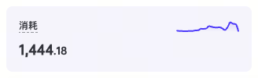
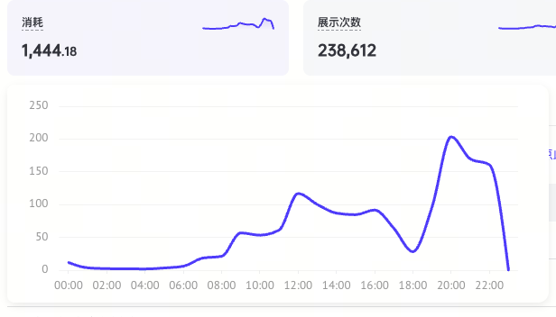
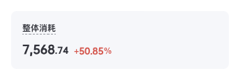
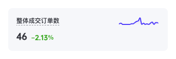
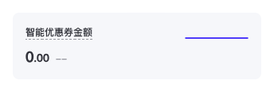
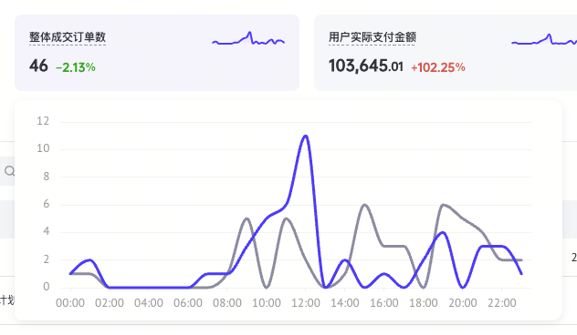
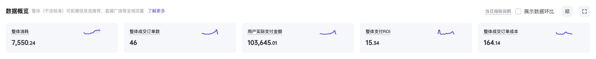
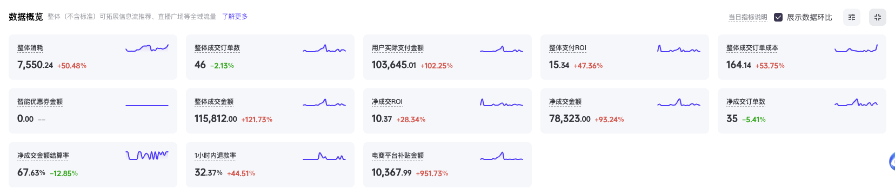

# 指标卡与趋势

来源：品牌投放与竞价全域账户页；原始计算值见 `specs/metric-card*.json`、`specs/metric-comparison*.json`、`specs/trend*.json`。截图和原始数据只作视觉参考，模板不带参考站点的账户数据。

| 部位 | 规格 |
|---|---|
| 指标组 | 横向等宽，间距 16px；空间不足时换行，禁止压缩成不可读的数字 |
| 卡片 | 高 84px、圆角 8px、内边距 16px、无描边、无阴影 |
| 默认底色 | `#F5F7FA` |
| 展开趋势时的底色 | `rgba(42,85,229,0.06)` |
| 标题行 | 高 18px，与数值相隔 10px |
| 标题 | 12px / 18px、700、`#31343B`；参考站点带虚线解释提示，复用 `HintText` 实现真实说明 |
| 数值整数 | 16px / 24px、700、`#31343B` |
| 小数 / 百分号 | 12px / 18px、700，与整数共基线 |
| 迷你趋势线 | 80×16px，位于右上角；单条蓝线、不显示坐标轴、网格、点标记或图例 |

## 悬停展开

| 部位 | 规格 |
|---|---|
| 触发 | 悬停右上角迷你线，不是整张指标卡；键盘可聚焦并点击打开 |
| 弹层 | 位于触发项下方，白底、宽 600px、高约 242px、圆角 12px |
| 阴影 | `0 3px 9px rgba(0,0,0,0.08)` |
| 绘图区 | 590×242px；小屏幕限制在视口减 32px 内 |
| 线 | `#0057FF`、2px、平滑连接，不显示每个数据点的数字；迷你线 1.5px |
| 坐标 | 12px、`#93969D`，横轴时间，单一纵轴，网格为浅色实线 |
| 读取 | 大图内按时间展示悬停读数；数据表也能读到对应值 |

## 展示数据环比

| 部位 | 规格与行为 |
|---|---|
| 开关 | 16px 复选框，4px 圆角；选中背景和描边 `#38374F`，白色勾；文字 14px / 22px |
| 环比 | 数值后 8px，12px / 18px、700、底部 1px 微调；正数带 `+`，负数带 `-` |
| 上涨 / 下降 | 原站按符号着色：上涨 `#E34949`、下降 `#0DA600`；不代表业务上好坏 |
| 零变化 / 缺失 | 零显示 `0.00%`；无有效基期显示 `--`、`#93969D`，不除以零、不伪造百分比 |
| 迷你线 | 仍只显示本期蓝线；开关不改变卡片高度或数值位置 |
| 大图 | 本期 `#0057FF`，上期 `#8A8DA3`，同一指标、同一坐标轴 |
| 数据 | `comparison.percent` 以百分数传入，例如 `2.13` 对应 `+2.13%`；上期数据按相同小时或序号标签对齐 |

上期数据使用与本期相同的时间槽 `label`，实际日期由 `currentLabel` / `previousLabel` 命名。未对齐或缺失的点保留断点；只有取得上期序列才绘制第二条线。

参考大图没有常驻图例，曲线均为实线。模板为可访问性补充“本期 / 上期”图例、终点文字，并将上期线改为虚线；两期数值也进入可聚焦的数据表。灰色是基期对照角色，不是第二个名义分类色：蓝色调色验证通过；灰线对白底对比度 3.27:1，CVD 和正常视觉区分通过；分类色脚本的灰度 chroma 检查不适用于此强调与中性对照。记录见 `specs/chart-comparison-palette.txt`。

## 展开 / 收起

| 状态 | 行为 |
|---|---|
| 收起 | 按当前已选顺序显示前 5 个；仅渲染可见卡片 |
| 展开 | 原位置显示全部已选指标；宽屏每行 5 个、间距 16px；示例 13 项形成 5 + 5 + 3 |
| 切换 | 保留环比和选择列状态，不改变表格排序或滚动容器；按钮 `aria-expanded`、`aria-controls` 同步 |
| 图标 | 32×32px 灰底按钮，16px 展开 / 收起图标；5 个以内时禁用 |
| 提示 | 悬停或聚焦显示“展开 / 收起”；深底 `rgba(50,51,53,0.95)`，12px 圆角，`8px 16px` 内边距，12px / 18px 白字 |
| 窄屏 | 逐级降为 3、2、1 列；卡片与列表不产生页面横向溢出 |

`MetricOverview` 的 `compare`、`expanded` 与回调均受控；`metrics` 按选择列弹窗确认后的顺序传入。`onConfigure` 打开 `ColumnChooserDialog`，用户取消后保留原列表。展开只增加指标行，不能用全屏遮罩替代。

## 模板与依赖

复制 `MetricOverview.tsx`、`MetricCard.tsx` 和 `TrendChart.tsx`，及其依赖的 `SectionHeader`、`ControlButton`。Tooltip 由项目 `Tooltip.Provider` 包裹。趋势图用 **ECharts 6.0.0** 的模块入口和 SVG renderer；用 `ResizeObserver` 跟随尺寸，卸载时 dispose，不另建自绘图表引擎。

- Skill 预览：`npm ci --ignore-scripts` 只安装 Skill 自己的 ECharts。
- 集成业务前检查项目是否已有图表库；已有则适配现有库，避免重复。采用本模板时 `pnpm --filter @zhx/web add echarts@6.0.0`。
- `TrendPoint.value = null` 保留断点，不把缺失数据当 0；禁止靠示例数据冒充接口结果。
- 不同单位的指标分图展示，禁止用双纵轴制造关联。
- 图表单序列使用 `#0057FF`；调色验证在 `specs/chart-palette.txt`，背景白色。
- 当前参考规范是浅色模式；深色版本需单独验证，不能直接反色。

`gallery/main.tsx` 中的数值是明确标注的组件夹具，只用于本地预览。模板采用项目字体，不照搬第三方字体。
