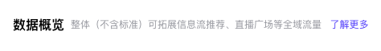
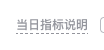

# 组件内小标题与说明

卡片 / 区块顶部一行：左边小标题 + 一句描述 + 「了解更多」，右边放带说明的虚线文字等控件。仅用于卡片或区块内部；页面级标题见 [surfaces.md](surfaces.md) 的页面标题栏。数值来自 `specs/section-header.json`、`specs/hint-text.json`、`specs/hint-popover.json`。

| 组件 | 模板 |
|---|---|
| 小标题 + 描述 + 了解更多 | `templates/SectionHeader.tsx` |
| 带说明的虚线文字 + 说明弹层 | `templates/HintText.tsx` |

## 小标题 · 描述 · 了解更多

| 部位 | 规格 |
|---|---|
| 小标题 | 16px / 32px，600，`#000000`，高 32px，不换行 |
| 描述区 | 紧跟标题，左间距 8px；12px，行高 1.15（13.8px） |
| 描述文字 | `#93969D`，400，一行，超出截断 |
| 了解更多 | 12px，400，`#0057FF`，无下划线，手型光标；与描述间隔约 12px |

描述只写标题没说清的那一句，能删就删；没有可跳转的文档就不放「了解更多」。

## 带说明的虚线文字

| 部位 | 规格 |
|---|---|
| 文字 | 12px / 18px，`#93969D`，手型光标 |
| 下划线 | 1px 虚线，颜色同文字，贴文字底部 |
| 字重 | 700，按用户提供与现场采集的计算值实现 |

下划线按参考截图使用虚线，计算值与实际效果的差异记录在 `overrides.json`。字体族继承项目 `font-sans`；不凭截图猜测并覆盖已采集的字重。

## 说明弹层

| 部位 | 规格 |
|---|---|
| 触发 | 悬停虚线文字（约 100ms 延迟），移开即关 |
| 位置 | 文字上方，间距约 8px，无箭头 |
| 容器 | 宽 320px，白底，圆角 12px，内边距 16px，阴影 `0 3px 9px rgba(0,0,0,0.08)` |
| 正文 | 12px / 18px，400，`#31343B` |
