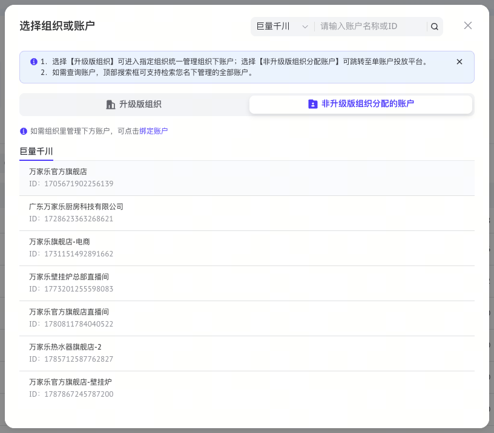
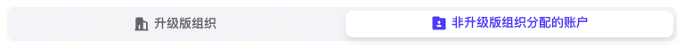
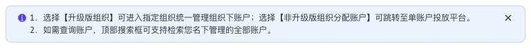
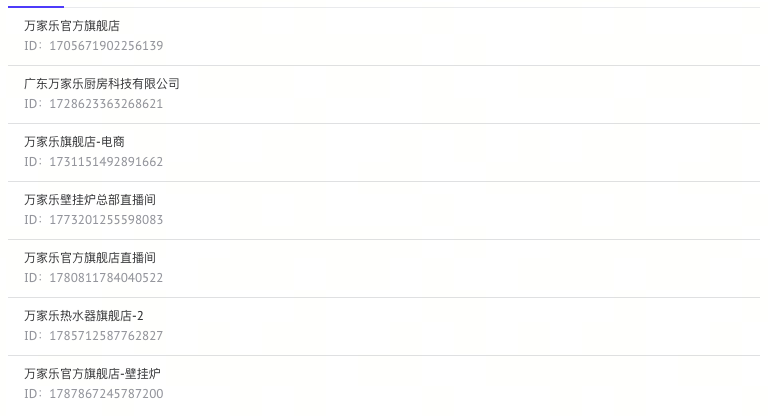
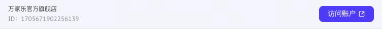

# 选择弹窗、分段 Tab 与列表

## 弹窗布局

| 部位 | 规格 |
|---|---|
| 容器 | 宽 800px、高 700px、白底、圆角 16px，居中；视口不足时距四边至少 16px |
| 阴影 | `0 3px 9px rgba(0,0,0,0.08)` |
| 遮罩 | `rgba(26,26,27,0.5)` |
| 内容 | 左右和下方 24px，顶部 20px，纵向 flex、`min-height:0` |
| 标题行 | 标题在左、搜索在右，关闭按钮独立在最右；窄屏允许搜索换行 |
| 标题 | 18px / 26px、600、`#323335` |
| 搜索 | 高 32px、灰底、圆角 8px，复用 `SearchFilter` |
| 内容顺序 | 标题搜索 → 说明条 → 分段 Tab → 可选说明 → 默认 Tab → 可滚动列表 |
| 滚动 | 只有列表滚动，标题与 Tab 保持可见；`overflow-y:auto` |
| 交互 | Escape 关闭、焦点限制在弹窗、关闭后恢复触发点；复用 Base UI Dialog |

## 分段 Tab

| 部位 | 规格 |
|---|---|
| 轨道 | 高 38px、`#F2F4F7`、圆角 8px、内边距 4px、项间距 8px |
| 项 | 等宽、高 30px、内边距 `4px 16px`、圆角 8px |
| 文字 | 14px / 22px、600；图标 16px，图文间距 4px |
| 未选中 | 透明底、`#62656C` |
| 选中 | 白底、`#0057FF`，阴影 `0 4px 8px rgba(0,0,0,0.1)` |
| 键盘 | 左右键移动焦点，Enter / Space 确认切换，Tab 可进入/退出；Base UI Tabs 处理焦点与 ARIA |

## 说明条

背景 `#E8F4FF`，1px `rgba(42,85,229,0.2)` 描边，圆角 8px，内边距 `8px 16px`。正文 12px / 18px、400、`#31343B`，左侧蓝色信息图标，右侧可关闭。说明可省略，内容应影响用户选择，禁止堆砌辅助文字。

## 选择列表

| 部位 | 规格 |
|---|---|
| 行 | 约 58px，左右内边距 16px、上下 12px、下方 1px `#DFE0E2` |
| 名称 | 12px / 18px、400、`#323335`；溢出截断 |
| ID | 第二行，12px / 18px、400、`#93969D` |
| 默认 | 透明背景，操作不抢占视觉焦点 |
| 悬停 | 背景 `rgba(242,245,253,0.79)`，右侧显示蓝色主按钮 |
| 键盘 | 焦点进入行内按钮时也显示操作，不能只能用鼠标选中 |
| 搜索 | 输入名称或 ID 筛选；无结果显示明确空态 |

模板：`SelectionDialog.tsx`（组合）、`SegmentedTabs.tsx`、`NoticeBanner.tsx`。列表数据、分页、加载状态由业务提供。模板标题与文案用项目术语，不复制第三方组织名称、图标或业务流程。
