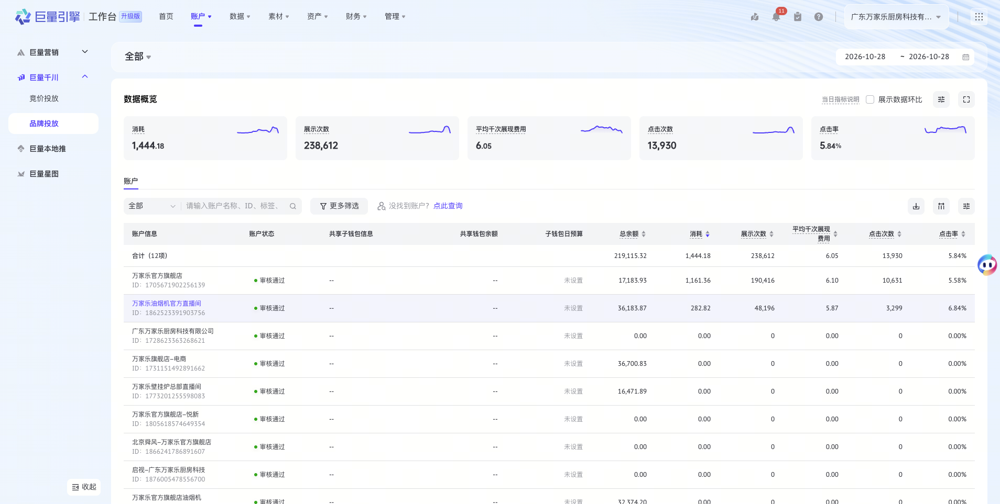

# 页面背景与容器

| 层级 | 规格 |
|---|---|
| 页面底层 | `linear-gradient(84deg, #F0F8FF -73.41%, #E8F4FF 91.31%)` |
| 顶部筛选栏 | 半透明白 `rgba(255,255,255,0.4)`、圆角 16px、桌面高 58px、左右内边距 24px |
| 页面标题 | 18px / 22px、600、`#31343B` |
| 页面标题栏 | 白底、圆角 12px、桌面最小高 58px、左右内边距 24px（手机 16px）；标题按上行，描述沿用 [section-header.md](section-header.md) 的描述样式并单行截断，操作按钮靠右 |
| 筛选栏与内容 | 垂直间距 12px |
| 内容卡片 | 白色、圆角 12px、内边距 24px，常态无描边、无阴影 |
| 内容间距 | 小间距 8px / 12px，常规 16px，大区块 24px |
| 手机适配 | 页面边距 16px，内容内边距 16px，控制栏可换行；数据表自身横向滚动，禁止整页横向溢出 |

模板：`templates/SurfaceLayout.tsx`。

页面标题栏采用组合规格：白底取内容卡片，标题取页面标题，不是单独采样的参考组件。实现时优先复用目标项目的页面标题组件；不要套用 section-header 的 16px 卡片内小标题。

参考站点在渐变上叠加了第三方波纹图片（`ocean_bg_ripple.png`）。模板保留纯 CSS 渐变，不热链站点素材；如果补充本项目自己的背景图，用本地资源，并记录路径、适用尺寸及来源。

原站将数据概览和下方表格拼成同一张卡片，上块圆角为 `12px 12px 0 0`。模板合成单个内容容器，因此外圈四角 12px，已记录在 `overrides.json`。
