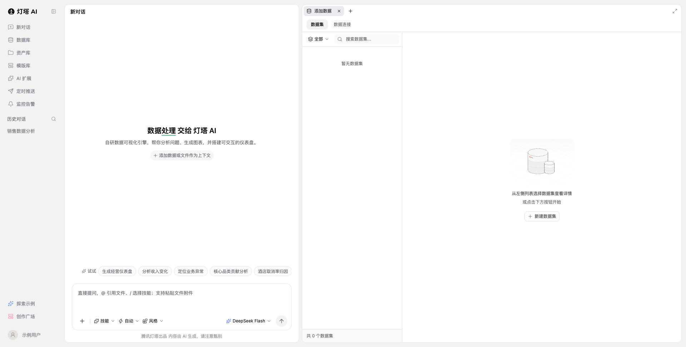

# 腾讯灯塔前端规范

独立的 React 前端 Skill，提供腾讯灯塔数据工作台的组件规范、可控源码和可运行预览。首个页面覆盖导航侧栏、对话区、数据集工作区及其空态。



| 入口 | 内容 |
| --- | --- |
| [SKILL.md](SKILL.md) | 按任务选择规范、模板与验证流程 |
| [templates](templates/) | 整页布局、输入区、数据工作区、菜单与弹窗 |
| [references](references/) | 布局参数、交互边界和实测样式 |
| [参考截图](references/shots/workbench-desktop.png) | 桌面页面，账户与历史文字已替换 |
| [scripts/verify.mjs](scripts/verify.mjs) | 本地交互与布局检查，输出截图和 JSON 结果 |

## 独立预览

需要 Node.js 20.19+ 或 22.12+ 与 npm。在本目录执行：

```bash
npm ci --ignore-scripts
npm run check
npm run gallery
```

打开 `http://127.0.0.1:5192`；`http://127.0.0.1:5192/?view=mysql` 直接打开 [MySQL 数据连接表单](references/connection-form.md)。生产构建使用 `npm run build`，预览构建结果使用 `npm run preview`。

组件依赖为 React、Base UI、Lucide 和 react-resizable-panels；样式使用本目录的 CSS，不要求 Tailwind 或外部业务项目。依赖版本由 `package-lock.json` 固定。

## 页面能力

| 区域 | 已实现 |
| --- | --- |
| 导航 | 侧栏收起、历史列表展开与搜索，新对话重置 |
| 对话区 | 建议填入、受控输入、Enter 发送与 Shift+Enter 换行，附件名称管理，模型、模式、技能及风格选择 |
| 工作区 | 可调整分栏、铺满与恢复、关闭页签与重新打开 |
| 数据集 | 来源与名称组合筛选，本地示例数据集创建、表格预览与删除 |
| 数据连接 | 数据库类型选择、MySQL 表单、HTTP/TCP 切换、原页必填提示、管理员弹层搜索多选，本地摘要创建、筛选与删除 |
| 窄屏 | 对话与数据视图切换，控件保持可访问 |

模型选择仅改变界面状态；消息、附件及示例数据集仅存在于当前页面内存。其他功能入口提供边界说明，不连接真实模型、账户、数据库或上传服务。风格选择是轻量本地菜单，不包含完整风格库。

“连接测试”仅校验本地字段，明确说明未连接数据库。提交后只保存连接摘要，不保存用户名或密码；刷新后清空。


## 浏览器验证

先启动本地预览，再用 `ego-browser nodejs` 导入脚本；将路径替换为本 Skill 的绝对路径：

```javascript
const { main } = await import('file:///absolute/path/tencent-beacon-frontend/scripts/verify.mjs');
await main({ url: 'http://127.0.0.1:5192', output: '/tmp/tencent-beacon-verify' });
```

复用已有任务空间时，传入 `taskSpaceId` 和 `pageLabel`；该页面必须用于本地预览，验证会重新加载并重置它。自行创建的空间在成功后释放，复用的空间由调用方管理。输出包括桌面、菜单、数据表和窄屏截图，以及逐项检查结果。

本次 [29 项浏览器检查](references/verification.json)均通过，覆盖工作台及连接表单；类型检查及生产构建需在修改后重新运行。Skill 尚未安装到真实客户端，Agent 发现需单独确认。

## 视觉约定

MySQL 表单按原页计算样式还原字体、11/12/13px 字号、阴影、品牌图标和控件形态；[样式比对报告](references/form-fidelity.json)记录 216 项属性、40 项几何值和 2 项焦点态检查。保留减少动态效果偏好。文字型菜单使用单个 Lucide ChevronDown，长值在图标前截断；图标型“新建”和“添加内容”按参考页保留单加号入口。

为复刻目标保留原页标题、描述、空态说明和建议按钮；未添加新的宣传文案。标题固定展示“数据处理”，不重复原页轮换动画；对话区文字已按原页恢复字体、字重、字号与抗锯齿，91 项属性比对通过；其余区域仍有初版阴影和字号简化，尚未逐项校准，不作为原页规范。这些差异及交互范围见 [Reference](references/workbench.md)。

## 许可

此 Skill 尚未声明许可证。腾讯灯塔品牌、页面参考截图和空态插图的权利说明见 [NOTICE.md](NOTICE.md)。

表单界面设计可直接引用 [表单填写界面引用规范](references/form-design.md)，包含任务引用方式、字段定义、排版尺寸、控件状态、响应式与验收规则。
