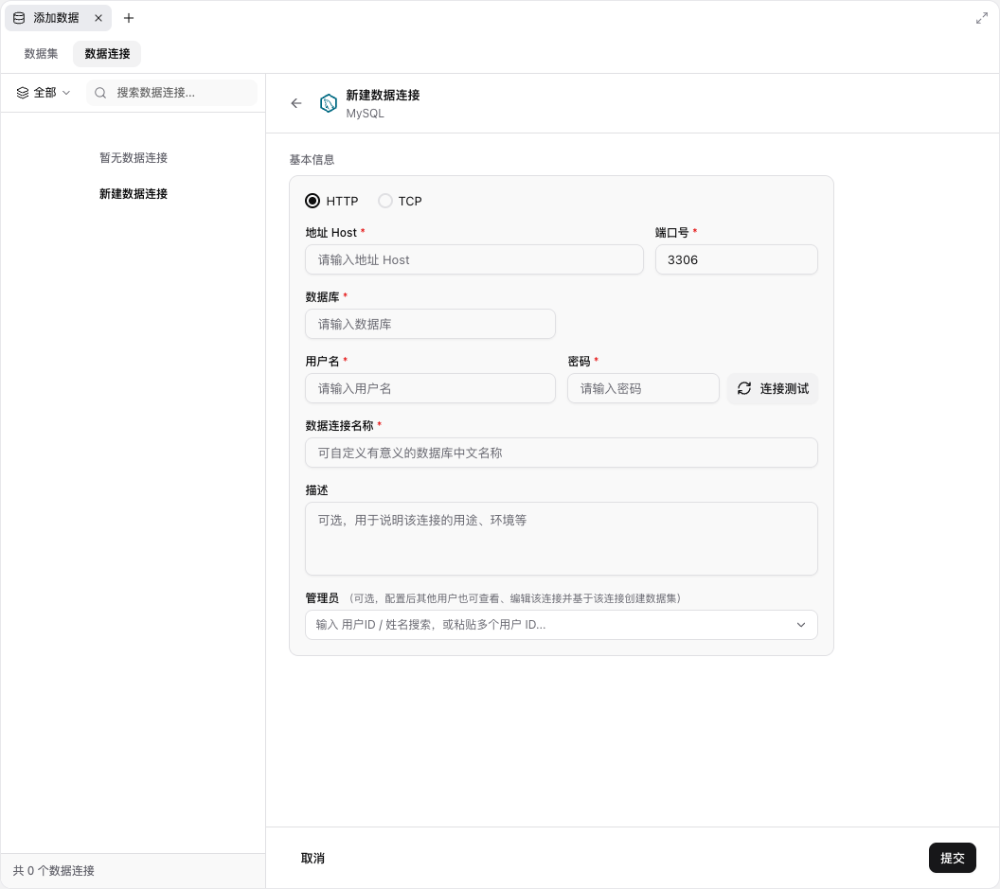

# MySQL 数据连接表单

可复用的布局、排版、控件与状态约束见 [表单填写界面引用规范](form-design.md)。本页补充 MySQL 专用流程和实现边界。

模板：`templates/BeaconConnectionForm.tsx`。原页实测基准：[connection-form.json](specs/connection-form.json)，采集日期 2026-10-30。截图用于外观对照，计算样式用于核对字号、尺寸与状态。

“新建 → 添加数据”打开数据工作区；“数据连接”打开数据库类型选择页，选择 MySQL 后进入表单。取消或返回回到类型选择页。`?view=mysql` 可直接预览表单。

| 部位 | 原页规格 |
| --- | --- |
| 字体 | -apple-system、system-ui、PingFang SC、Segoe UI、sans-serif |
| 标题 | 13px / 20px，600；类型 12px / 16px，400 |
| 标签 | 12px / 16px，500 |
| 输入、协议与按钮 | 13px / 20px，输入 400、按钮 500 |
| 管理员说明 | 11px / 16px，400 |
| 标题栏 / 底栏 | 63px / 65px |
| 卡片 | 最大宽 576px，内边距与组间距 16px，圆角 10px |
| 地址 / 端口 | 三等列，地址跨两列，间距 12px，默认端口 3306 |
| 用户名 / 密码 | 两等列，间距 12px；密码输入与测试按钮间距 8px |
| 输入 | 高 32px，圆角 8px，左右内边距 12px，1px 边线和原页轻阴影 |
| 描述 | 高 78px，不可拖动调整高度 |
| 管理员 | 闭合为按钮，弹层内搜索；单个 14px ChevronDown |
| 焦点态 | 蓝色边线、3px 半透明焦点环，保留正常阴影 |

## 交互和服务边界

空提交先提示“请填写数据连接名称”；填名称但缺连接参数，或空参数连接测试，提示“请填写完整的连接信息”。提示位于卡片底部，12px 红字和 14px 警告图标。编辑时保留提示，下一次校验更新；不使用浏览器原生校验气泡，也不添加未实测的端口范围限制。

管理员候选由 `administratorOptions` 提供，默认空列表，不注入虚构通讯录。预览支持输入 ID、多选和粘贴分隔 ID；这些本地交互不代表已接入原站目录。连接测试只显示本地预览说明，不请求真实数据库。提交仅创建内存摘要，用户名和密码不存入摘要，刷新清空记录。

类型页保留 MySQL、StarRocks、PgSQL、ClickHouse 及对应品牌 SVG，目前仅 MySQL 表单完成复刻。其余类型明确提示尚未复刻。

## 验证和明确例外

[form-fidelity.mjs](../scripts/form-fidelity.mjs) 比较默认表单 216 项样式属性、40 项尺寸和相对位置，49 项 placeholder 属性（包括字体抗锯齿），以及 2 项输入焦点属性；[结果](form-fidelity.json)。浏览器功能检查另见 [verification.json](verification.json)。比较覆盖的属性通过，不代表所有页面、状态或像素都已一致。

为忠实复刻，保留原页 11px 说明、品牌图标、1px 边线、单选框 2px 描边、阴影、焦点环和字段说明，明确优先于通用字号下限、统一操作图标和表面简化约定。窄屏单列与隐藏列表是本地适配，未作为原站移动版实测结论。

表单根节点继承原页 `-webkit-font-smoothing: antialiased`。仅相同的 font-weight 不保证 macOS 上笔画观感一致；占位符仍为 400，不用降低字重补偿渲染差异。
