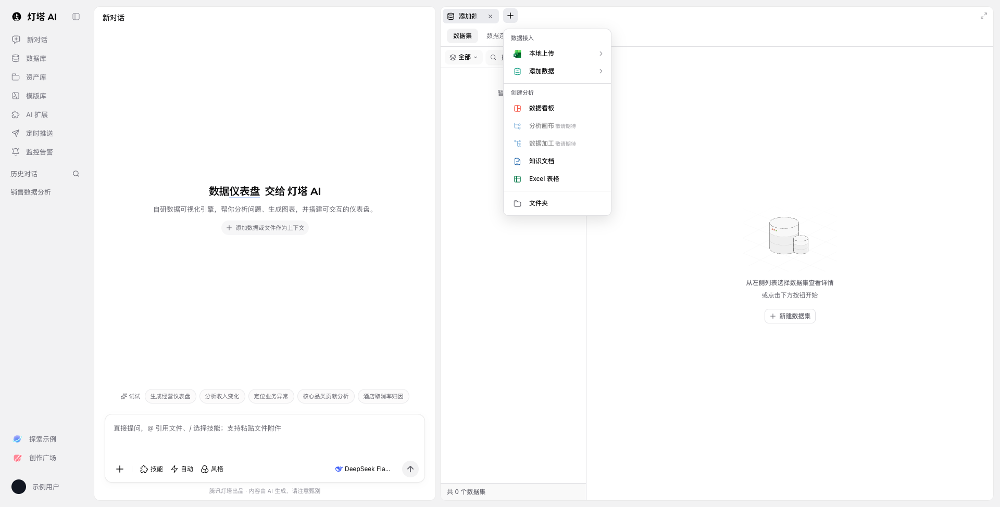

# 交互状态与验证

| 操作 | 预览行为 | 与参考范围的关系 |
| --- | --- | --- |
| 收起侧栏 | 导航变为图标列，再次展开恢复 | 保留页面入口及布局意图 |
| 调整分栏 | 指针拖动或分隔线键盘调整 | 使用成熟布局库 |
| 铺满 / 退出铺满 | 收起对话面板，再恢复尺寸 | 本地实现 |
| 新建菜单 | 按“数据接入 / 创建分析”分组；禁用未就绪项 | 按实测菜单结构复刻 |
| 来源菜单 | 全部、本地文件、腾讯文档、飞书文档、钉钉文档及数据库来源 | 按实测菜单内容复刻 |
| 输入工具 | 选择后更新标签；Escape 关闭，焦点返回入口 | 菜单由 Base UI 管理 |
| 模型选择 | 切换显示名称，不请求服务 | 名称为页面采集值，布局简化 |
| 风格选择 | 本地菜单 | 不包含原页 25 项预览图库 |
| 新建数据集 | 名称与来源表单，提交虚构数据 | 演示补充；未操作真实站点数据 |
| 新建数据连接 | MySQL 表单、协议切换、管理员多选、字段校验及本地摘要 | 按原页实测复刻；先选数据库类型再进入 MySQL；不请求数据库，管理员候选由调用方提供 |
| 发送 | 显示本地文本和预览说明 | 演示补充；无真实模型输出 |
| 其他导航 | 弹窗说明当前页面范围 | 不声称已实现站点其他模块 |

`WorkbenchMenu` 管理所有菜单，不另写点击外部、焦点环或 Escape 处理。菜单浮层在弹窗上方，避免嵌套数据来源选择器被遮挡。`WorkbenchDialog` 使用 Base UI Dialog，关闭后恢复焦点。

浏览器检查脚本 [verify.mjs](../scripts/verify.mjs) 限制为本地地址，重置预览后验证几何位置、空态、键盘、来源与名称组合筛选、本地数据表及窄屏。报告保存在调用者指定目录。参考截图与静态样式不能替代真实业务集成验收。
