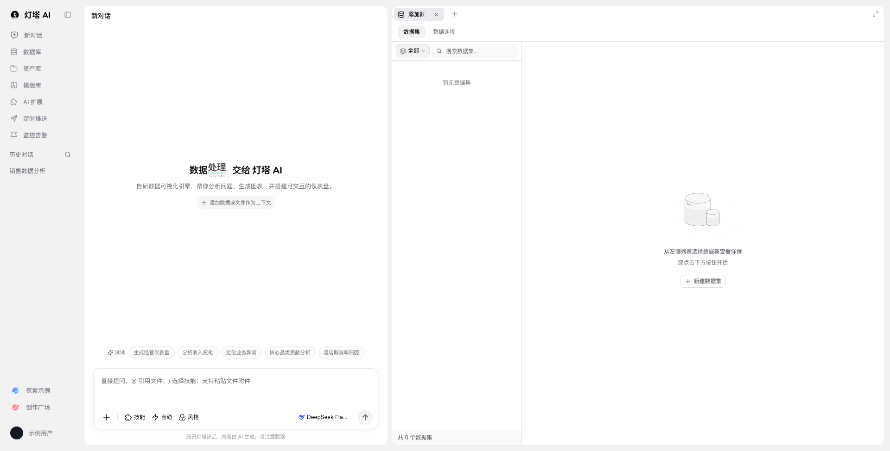

# 工作台布局

| 部位 | 实测规格 / 模板约定 |
| --- | --- |
| 桌面基准 | 1920 × 975 CSS px，DPR 1 |
| 页面外壳 | 浅灰 `#f4f4f5`，外边距 12px |
| 侧栏 | 含内边距约 156px，导航按钮高 32px，垂直间距 4px |
| 对话面板 | x=180px，宽约 657px，白底、圆角 12px |
| 工作区 | x≈846px；与对话区间隔 8px，可键盘或指针调整 |
| 基础文字 | 系统字体，13px / 20px；次要文字 `#71717a`，侧栏图标与文字 `#8b8b95` |
| 页内标题 | 14px、500；居中主标题 20px、600 |
| 输入区 | x=201px，y=796px，约 615 × 132px；详见 [composer.md](composer.md) |
| 面板边界 | 只在独立工作面板、列表分区与控件需要分组时描边 |

计算样式和测量时间见 [workbench.json](specs/workbench.json)。原页标题词语随时间轮换，因此标题文字宽度不作为稳定几何断言。

模板入口为 `templates/BeaconWorkbench.tsx`，样式位于 `templates/beacon.css`。`Group` / `Panel` / `Separator` 来自 react-resizable-panels；尺寸使用库当前版本定义的显式百分比或像素值。不要手写第二套拖动状态。

## 窄屏

760px 及以下改为顶部“对话 / 数据”切换，隐藏另一面板而保留其 React 状态。两种视图均不允许整页横向溢出；数据表本身可横向滚动。1050px 以下压缩侧栏为图标列。窄屏规则是模板的适配方案，未将其表述为原站手机实测结果。

## 表单之外的初版差异（待校准）

MySQL 表单与对话区文字已单独按原页实测恢复，以下简化不适用于表单或对话区文字，也不应作为后续复刻规范。见 [connection-form.md](connection-form.md)。

| 项目 | 模板处理 |
| --- | --- |
| 个人内容 | 账户名、头像及历史记录使用通用示例；参考截图在本地替换个人文字后保存 |
| 标题 | 固定“数据处理”，移除轮换动画；已恢复原页标题及品牌字体 |
| 字号 | 只使用 12 / 13 / 14 / 20px；原页更小的提示也提升到 12px |
| 表面 | 移除输入框和搜索框的多层投影，使用边线 |
| 边线 | 统一 `--beacon-line`，DPR 2 及以上使用 0.5px |
| 菜单 | 文字型触发器统一单 ChevronDown；两处图标型加号菜单保留原页形态，不额外添加箭头 |
| 文案 | 为复刻保留原页标题、描述、空态及建议；对话页脚已恢复原页分隔 |
| 资源 | 品牌 SVG 与空态插图本地存放；外部 SVG 补充命名空间，空态背景使用白色以匹配页面样式 |
| 业务交互 | 只有本地演示，未连接实际模型或数据服务；见 [interactions.md](interactions.md) |

品牌文案、说明性文字和加号菜单属于本次复刻对通用精简文案及菜单箭头约定的明确例外；制作新产品时不自动沿用这些例外。
